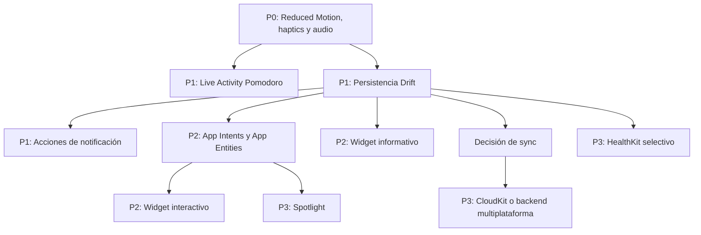

# Zentra: revisión de integración premium con el sistema

**Fecha de evaluación:** 25 de julio de 2026  
**Objetivo:** convertir el feedback de liderazgo en un plan técnico verificable para el rebranding de Zentra  
**Alcance:** iOS como superficie premium principal, con fallbacks explícitos para Android  
**Snapshot evaluado:** working tree local de Zentra `1.0.20+24`

> Nota de frescura: el working tree contiene cambios locales amplios y archivos sin
> commit. Este documento describe el estado ejecutable observado el 25 de julio de
> 2026, no afirma que todas estas piezas estén en la versión publicada de App Store.

## 1. Veredicto ejecutivo

La dirección de liderazgo es correcta: el siguiente salto premium de Zentra no debe
venir de agregar más estímulos dentro de la interfaz. Debe venir de una presencia
discreta y útil en las superficies del sistema.

Sin embargo, el plan propuesto necesita cuatro ajustes antes de convertirse en
backlog:

1. Algunas capacidades ya existen parcialmente. Hay scaffolding para Live
   Activities, un target de widget y un servicio Dart para Siri, pero ninguno está
   completo o conectado end to end.
2. ProMotion y notificaciones `timeSensitive` ya están configurados. No deben
   planearse como implementaciones nuevas, sino como capacidades por validar.
3. No hace falta migrar de `audioplayers` a `just_audio` para mezclar un sonido breve
   con Spotify. La librería actual ya puede usar una sesión iOS `ambient`.
4. Un widget interactivo, App Intents que muten datos e iCloud sync dependen de una
   capa de persistencia transaccional y compartible. `SharedPreferences` no debe ser
   la fuente canónica para esas superficies.

### Recomendación de inversión

| Capacidad | Decisión | Prioridad |
|---|---|---:|
| Reduced Motion | Implementar | P0 |
| Gramática háptica con Core Haptics | Implementar | P0 |
| Audio `ambient` y cold start | Implementar sin migrar de player | P0 |
| Live Activities para Pomodoro | Implementar completando el scaffold nativo | P1 |
| Acciones en notificaciones | Navegación P1, mutaciones P2 | P1/P2 |
| Migración de persistencia a Drift | Implementar como habilitador | P1 |
| Widget informativo | Implementar después de Live Activities | P2 |
| App Intents y widget interactivo | Implementar después de persistencia | P2 |
| Rive | Hacer spike limitado a una animación firma | P2 |
| Sincronización | Decisión de producto y arquitectura antes de implementar | P2 |
| HealthKit | Implementar sólo para sesiones realmente mindful | P3 |
| Core Spotlight | Integrar preferentemente mediante App Entities | P3 |
| Íconos alternativos | Implementar nativo y opt-in | P3 |
| ProMotion | Ya configurado, sólo validar | Validación |

Las etiquetas P0 a P3 expresan urgencia y dependencia de producto. No son el número
de la fase de entrega.

## 2. Estado real verificado en el repositorio

### 2.1 Base actual

- Flutter 3.38.3 y Dart 3.10.1.
- Deployment target principal de iOS en 13.0.
- Persistencia canónica en `SharedPreferences`.
- Pomodoro respaldado por timer Dart, notificación programada y
  `flutter_foreground_task`.
- Acciones rápidas de Home Screen ya declaradas para nuevo hábito, Pomodoro y
  progreso.
- Notificaciones Pomodoro ya usan `InterruptionLevel.timeSensitive`.
- `CADisableMinimumFrameDurationOnPhone` ya es `true`.
- La app ya tiene un App Group: `group.com.jesutorr.zentra`.
- No existen capabilities de HealthKit o iCloud en los entitlements actuales.
- No existe soporte de Reduced Motion en la capa Flutter.

### 2.2 Punteros de evidencia local

| Hallazgo | Evidencia |
|---|---|
| Versión y dependencias actuales | `pubspec.yaml:4`, `pubspec.yaml:9` |
| Persistencia JSON en SharedPreferences | `lib/infrastructure/local_storage_repository.dart:5`, `:86`, `:141` |
| Historial Pomodoro limitado a 30 días | `lib/core/constants.dart:37` |
| ProMotion habilitado | `ios/Runner/Info.plist:5` |
| Quick Actions declaradas | `ios/Runner/Info.plist:31` |
| App Group de Runner | `ios/Runner/Runner.entitlements:5` |
| Live Activity bridge Dart | `lib/infrastructure/live_activity_service.dart:4` |
| ActivityAttributes incompleto | `ios/Runner/ZentraActivityAttributes.swift:5` |
| Target de widget | `ios/Runner.xcodeproj/project.pbxproj:216` |
| Fase de embed vacía | `ios/Runner.xcodeproj/project.pbxproj:34` |
| Deployment target de extensión en 26.1 | `ios/Runner.xcodeproj/project.pbxproj:597` |
| Scaffold Siri sin callers | `lib/infrastructure/siri_shortcuts_service.dart:5` |
| `timeSensitive` ya usado | `lib/infrastructure/notification_service.dart:394` |
| Servicio de sonido sólo inicializado desde Settings | `lib/presentation/settings_screen.dart:275` |
| Patrón success de cuatro haptics | `lib/presentation/utils/feedback_utils.dart:33` |

### 2.3 Scaffolding que no debe confundirse con funcionalidad terminada

#### Live Activities

Existen:

- `lib/infrastructure/live_activity_service.dart`
- `ios/Runner/ZentraActivityAttributes.swift`
- Un target Xcode llamado `ZentraWidgetExtension`

Falta:

- El `MethodChannel` nativo `com.jesutorr.zentra/live_activity`.
- Llamadas al servicio desde `PomodoroProvider`.
- `ActivityConfiguration` y las vistas SwiftUI de Lock Screen y Dynamic Island.
- `NSSupportsLiveActivities` en `Info.plist`.
- Fuentes reales dentro de `ios/ZentraWidget/`.
- Entitlements del App Group para la extensión.
- Embebido de `ZentraWidgetExtension.appex` en Runner.
- Tests de lifecycle.

Además, el target de extensión tiene deployment target 26.1 mientras la app principal
mantiene 13.0. Esa combinación debe corregirse con una decisión explícita de
compatibilidad. El valor 26.1 no debe llegar accidentalmente a producción.

**Conclusión:** actualmente Live Activities no es una feature operativa. Es un inicio
de implementación.

#### Widgets

El target Xcode existe, pero el grupo sincronizado `ios/ZentraWidget/` no existe en
disco y la fase `Embed Foundation Extensions` está vacía.

**Conclusión:** Zentra todavía no entrega un widget.

#### Siri y Shortcuts

Existe `lib/infrastructure/siri_shortcuts_service.dart`, pero:

- No se inicializa desde `main.dart`.
- No se encontraron callers de sus métodos de donación.
- AppDelegate no registra el canal `com.zentra.app/siri`.
- No hay implementación de `AppIntent`, `AppEntity` o `AppShortcutsProvider`.

Las Quick Actions del ícono sí son funcionalidad distinta y no equivalen a Siri o
App Intents.

**Conclusión:** Siri y Shortcuts todavía no están integrados end to end.

#### Notificaciones

El fin de enfoque y de descanso ya usa `timeSensitive`. Lo que falta son categorías,
botones y manejo de acciones en background.

#### ProMotion

`ios/Runner/Info.plist` ya contiene:

```xml
<key>CADisableMinimumFrameDurationOnPhone</key>
<true/>
```

No se necesita otra tarea de configuración. Sí se necesita perfilar una build
`profile` en un iPhone Pro físico y confirmar frame pacing.

## 3. Principios de la integración premium

Toda capacidad nueva debe pasar estas cinco reglas:

1. **Reduce aperturas, no agrega ruido.** La superficie de sistema debe resolver o
   resumir una acción.
2. **Una fuente de verdad.** App, widget, App Intent y notificación no pueden escribir
   representaciones distintas del mismo hábito.
3. **Degradación elegante.** Si el sistema no soporta una capacidad o el usuario la
   desactiva, Zentra conserva su flujo normal.
4. **Privacidad por defecto.** El nombre de un hábito o actividad puede ser sensible en
   una pantalla bloqueada.
5. **Android explícito.** Cada feature iOS debe declarar su fallback Android o marcarse
   como diferenciador exclusivo.

### Matriz de paridad

| Capacidad | iOS | Android |
|---|---|---|
| Haptics firma | Core Haptics | Un solo feedback nativo, sin intentar copiar el waveform |
| Pomodoro fuera de la app | ActivityKit y Dynamic Island | Foreground notification actual |
| Widget | WidgetKit y SwiftUI | Glance o RemoteViews mediante `home_widget` |
| Acciones de sistema | App Intents, Siri y Shortcuts | Deep links, app shortcuts y notification actions |
| Salud | HealthKit para mindfulness explícito | Sin paridad en esta fase |
| Sync | CloudKit si se elige Apple-first | Requiere backend neutral |
| Íconos alternativos | API nativa de UIApplication | Evaluación separada por launcher |

La ausencia de paridad no debe bloquear una capacidad iOS valiosa, pero sí debe quedar
visible en alcance, marketing y soporte.

## 4. Mapa de dependencias



Live Activities puede avanzar antes de Drift porque representa el estado temporal del
Pomodoro. Las mutaciones de hábitos desde widgets, Siri o notificaciones sí deben
esperar una persistencia transaccional.

## 5. Evaluación detallada por capacidad

### 5.1 Core Haptics

**Decisión:** implementar.

#### Por qué

Core Haptics resuelve el principal problema sensorial detectado: una sola acción de
completar puede disparar hasta siete impactos genéricos. `CHHapticEngine` permite
reemplazar ese stack por un patrón corto con identidad.

#### Diseño recomendado

- Crear un único patrón firma `zentra_success.ahap`.
- Duración objetivo entre 180 y 320 ms.
- Un transient suave al confirmar.
- Una caída breve de intensidad que acompañe el cierre del check.
- Sin patrón separado para cada categoría.
- Mantener `selectionClick` nativo para pickers y toggles.
- Usar un solo haptic de error, sin secuencias agresivas.

#### Implementación

- Crear `ZentraHaptics` en Swift, separado de AppDelegate.
- Exponer `prepare`, `playSuccess`, `playWarning` y `stop` mediante un channel local.
- Consultar `CHHapticEngine.capabilitiesForHardware().supportsHaptics`.
- Conservar `HapticFeedback` como fallback.
- Precalentar el engine antes del primer uso razonable y permitir auto shutdown.
- Recuperarse de engine reset y app lifecycle.
- Agregar un setting de hápticos. Reduced Motion no debe apagar hápticos
  automáticamente, porque son preferencias de accesibilidad diferentes.

#### Criterios de aceptación

- Completar un hábito produce exactamente una señal háptica de éxito.
- Completar el último hábito no apila otra señal desde cada widget o diálogo.
- Funciona en un iPhone físico compatible.
- En hardware sin Core Haptics, usa un fallback único.
- Desactivar hápticos en Zentra deja la acción completamente silenciosa al tacto.

### 5.2 Rive para check y celebraciones

**Decisión:** spike limitado, no adopción general inmediata.

#### Corrección al feedback

Rive puede centralizar una animación en una state machine, pero no es automáticamente
más ligero que un `CustomPainter` ni respeta Reduced Motion por sí solo. La app debe
detener la state machine y presentar un frame estático.

#### Uso recomendado

Probar Rive únicamente para el check firma:

- `idle`
- `completing`
- `completed`
- `uncompleting`

El bloom debe formar parte de la misma composición. No debe coexistir con el bounce,
partículas, glow y confetti actuales.

#### Gate de adopción

Adoptar Rive sólo si:

- Diseño puede mantener el archivo `.riv`.
- El asset se distribuye localmente y no necesita red.
- La animación mantiene 60 y 120 fps en hardware real.
- El costo de tamaño y arranque es aceptable.
- Existen un frame estático y una ruta de Reduced Motion.
- Se puede probar el contrato de estados aunque el pixel rendering no sea golden.

Si el spike no demuestra una mejora clara, usar una animación Flutter propia con
tokens de movimiento. No se debe agregar Rive únicamente por prestigio técnico.

### 5.3 Audio premium

**Decisión:** conservar `audioplayers`, corregir inicialización y configurar sesión.

#### Por qué no migrar todavía

Zentra reproduce un sonido corto desde assets. `just_audio` aporta playlists, clipping,
streaming y otras capacidades que hoy no se necesitan. La interacción con Spotify es
una propiedad de `AVAudioSession`, no del nombre del player.

La versión actual de `audioplayers` ya soporta `AudioContextIOS` y categoría
`AVAudioSessionCategory.ambient`. Apple define `ambient` para audio no primario que
se mezcla con el audio de otras apps y respeta el switch de silencio.

#### Trabajo requerido

- Inicializar `SoundService` durante el arranque.
- Configurar la sesión iOS como `ambient`.
- Configurar Android como sonification sin tomar audio focus exclusivo.
- Precachear el asset.
- Asegurar que el setting de sonido se respete desde cold start.
- Probar con Apple Music, Spotify, podcast, Silent Mode y pantalla bloqueada.

#### Criterios de aceptación

- Un usuario con Spotify activo completa un hábito y Spotify no se pausa ni baja.
- El sonido de Zentra respeta Silent Mode.
- El setting persiste después de matar y abrir la app.
- Desactivar sonidos evita inicialización o reproducción innecesaria.

Agregar `audio_session` se justifica sólo si aparecen varios plugins de audio que
compiten por la sesión global. Migrar a `just_audio` queda fuera del rebranding actual.

### 5.4 Live Activities y Dynamic Island

**Decisión:** implementar como la principal superficie premium.

#### Por qué

Pomodoro es el caso de uso más claro de Zentra y la pantalla visualmente más madura.
Una Live Activity permite que la app desaparezca mientras el sistema muestra sólo lo
necesario.

#### Arquitectura recomendada

Preferir ActivityKit nativo y completar el bridge ya iniciado. No agregar un paquete
hasta decidir si aporta más que el scaffold existente.

La capacidad debe protegerse por disponibilidad porque Live Activities comienza en
iOS 16.1 y la app principal actualmente soporta iOS 13.

Si se elige paquete:

- `live_activities` es la opción Flutter más madura de las evaluadas.
- La versión más nueva evaluada requiere Dart 3.12.
- El proyecto usa Dart 3.10.1, así que habría que actualizar Flutter/Dart o evaluar una
  versión compatible como 2.4.7.
- El paquete no elimina el trabajo SwiftUI ni los requisitos de WidgetKit.

#### Estado mínimo de la Live Activity

- Nombre de actividad o etiqueta privada “Sesión de enfoque”.
- Tipo: enfoque, descanso corto o descanso largo.
- `timerEndTime`.
- Pausado o corriendo.
- Progreso semántico.
- Identificador de sesión.

Usar `Text(timerInterval:countsDown:)` o la API equivalente del sistema. No enviar
updates desde Flutter cada segundo. Flutter sólo debe actualizar al iniciar, pausar,
reanudar, cambiar de etapa y terminar.

#### Superficies

- Lock Screen.
- Dynamic Island compacta.
- Dynamic Island expandida.
- Dynamic Island minimal.
- Fallback sin Dynamic Island.

#### Interacción por fases

Primera entrega:

- Tocar abre Pomodoro en Zentra.
- No incluir pause o cancel desde la isla.

Segunda entrega:

- Pause o resume mediante App Intent.
- Finalizar con confirmación.

#### Casos de lifecycle obligatorios

- App en foreground.
- App en background.
- Flutter engine suspendido.
- App terminada por el sistema.
- Usuario pausa y reanuda.
- Usuario cancela.
- Timer termina mientras el teléfono está bloqueado.
- Cambio manual de hora y zona horaria.
- Reinicio de dispositivo.
- Live Activities desactivadas por el usuario.

#### Privacidad

Agregar un setting:

- Mostrar nombre de la actividad.
- Mostrar sólo “Sesión de enfoque” en Lock Screen.

#### Criterios de aceptación

- Nunca existen dos Live Activities para la misma sesión.
- La actividad termina al cancelar o terminar Pomodoro.
- El timer visible no se separa más de un segundo del estado de Zentra.
- No existe loop de updates por segundo desde Dart.
- Si ActivityKit no está disponible, la notificación programada sigue funcionando.
- La extensión está embebida, firmada y probada en dispositivo real.

### 5.5 Widgets de Home Screen y Lock Screen

**Decisión:** implementar en dos entregas.

`home_widget` puede facilitar el intercambio de datos y el refresh, pero no permite
escribir la UI del widget en Flutter. WidgetKit y SwiftUI siguen siendo obligatorios.

#### Entrega A: widget informativo

Implementar después de Live Activities:

- Widget circular de Lock Screen con progreso diario.
- Widget pequeño con anillo, completados y total.
- Widget mediano con siguiente hábito y progreso.
- Tap abre Today o el hábito correspondiente.

Flutter publica un snapshot versionado en el App Group:

```text
widget_snapshot_v1
  generatedAt
  userId
  completed
  total
  nextHabitId
  nextHabitTitle
  privacyMode
```

El snapshot es una proyección de lectura. No es la fuente canónica.

#### Entrega B: widget interactivo

Implementar sólo después de Drift y App Intents:

- Completar hábito.
- Deshacer.
- Abrir detalle.

La acción debe incluir un identificador idempotente. Dos taps o dos procesos no pueden
crear dos logs para el mismo hábito y fecha.

#### Riesgos

- Stale data si WidgetKit no recibe refresh.
- Conflictos si widget y app mutan un JSON completo en `SharedPreferences`.
- Exposición de títulos sensibles en Lock Screen.
- Diferencias de timezone para “hoy”.

#### Criterios de aceptación

- El widget muestra estado útil sin abrir Zentra.
- Un snapshot viejo se identifica por timestamp y no presenta una acción engañosa.
- El widget interactivo y la app producen el mismo resultado ante taps repetidos.
- Los títulos se redactan cuando privacy mode está activo.

### 5.6 App Intents, Siri y Shortcuts

**Decisión:** implementar con App Intents, no terminar el scaffold de donaciones
legacy como arquitectura principal.

App Intents permite reutilizar acciones en Siri, Spotlight, Shortcuts, Action Button,
widgets y Live Activities.

#### Intents iniciales

1. `StartFocusIntent`
   - Actividad opcional.
   - Duración opcional.
   - Primera versión puede abrir Zentra para iniciar.
2. `CompleteHabitIntent`
   - Parámetro `HabitEntity`.
   - Requiere persistencia compartida para ejecutarse sin abrir la app.
3. `OpenTodayIntent`
4. `ShowProgressIntent`

#### App Entities

Definir `HabitEntity` con:

- Identificador estable.
- Título.
- Categoría.
- Estado de hoy.
- Archivado.

No exponer en Siri hábitos archivados o títulos cuando privacy mode lo impida.

#### Criterios de aceptación

- Los shortcuts aparecen inmediatamente después de instalar.
- “Iniciar enfoque” funciona con la app cerrada o abre Zentra de forma explícita.
- “Completar hábito” es idempotente.
- Los hábitos eliminados desaparecen de sugerencias.
- Una acción puede reutilizarse desde Siri y un widget sin duplicar lógica.

### 5.7 Persistencia: Drift antes de superficies interactivas

**Decisión:** migrar de `SharedPreferences` a Drift.

#### Por qué Drift

El modelo actual lee y reescribe listas JSON completas de hábitos y logs. Es suficiente
para una app local pequeña, pero no para:

- Escrituras concurrentes desde extensión y app.
- Queries crecientes de calendario.
- Índices y agregaciones.
- Migraciones versionadas.
- Tombstones y resolución de conflictos.
- Sync incremental.

Drift está basado en SQLite, tiene transacciones, migraciones, queries tipadas y se
mantiene activo. La versión oficial de Isar evaluada lleva tres años sin una release
estable, y el working tree actual ya está eliminando una implementación Isar anterior.
No conviene resucitarla sin un motivo nuevo.

#### Tablas mínimas

```text
users
habits
habit_schedules
habit_logs
pomodoro_sessions
settings
sync_metadata
```

Cada entidad sincronizable debe incluir:

- UUID estable.
- `createdAt`.
- `updatedAt`.
- `deletedAt` o tombstone.
- Versión de schema.

`habit_logs` debe tener un unique constraint equivalente a:

```text
(userId, habitId, localDate)
```

#### Migración

1. Leer SharedPreferences sin modificarlo.
2. Validar y convertir a un modelo intermedio.
3. Escribir Drift en una transacción.
4. Comparar conteos y checksums.
5. Marcar migración completa.
6. Mantener backup exportable.
7. No borrar las llaves legacy hasta pasar al menos una release estable.

#### Criterios de aceptación

- Migración repetible e idempotente.
- Ante error, Zentra sigue abriendo los datos legacy.
- Ningún hábito o log desaparece.
- Calendario y progreso producen los mismos resultados antes y después.
- Existen tests de migración desde backups reales y datos dañados.

### 5.8 Sincronización iCloud

**Decisión:** no implementar hasta resolver el alcance multiplataforma.

#### Corrección al feedback

`icloud_storage` transfiere archivos en un contenedor de iCloud. No convierte Drift o
Isar en una base sincronizada ni resuelve conflictos. Además, la versión evaluada lleva
tres años sin publicación.

Existen tres rutas reales:

1. **Backup automático de archivo**
   - Más simple.
   - Recuperación, no sincronización continua.
   - Posibles sobrescrituras entre dispositivos.
2. **CloudKit privado con `CKSyncEngine`**
   - Sincronización Apple-first.
   - Requiere bridge nativo, change tokens, conflictos y cache local.
   - Android queda fuera.
3. **Backend neutral**
   - iOS y Android comparten datos.
   - Requiere identidad, backend, seguridad y costo operativo.

Core Data con `NSPersistentCloudKitContainer` ofrece mirroring nativo automático, pero
implicaría mover la fuente canónica a una tecnología no accesible directamente desde
Flutter. No debe mezclarse con Drift sin una arquitectura de ownership muy clara.

#### Decisión de producto requerida

Planeación debe elegir:

- Apple-first con CloudKit.
- Multiplataforma con backend.
- Backup automático primero y sync después.

Mi recomendación para el rebranding:

1. Drift local.
2. Backup automático recuperable.
3. Diseñar contrato de sync y resolución de conflictos.
4. Elegir proveedor en un spike separado.

#### Reglas mínimas de conflicto

- Logs de completado son append-only e idempotentes.
- Cambios de hábito usan versión y `updatedAt`.
- Eliminación crea tombstone.
- No se debe revivir automáticamente un hábito eliminado en otro dispositivo.
- La racha se deriva de logs, no se sincroniza como contador mutable.

### 5.9 HealthKit

**Decisión:** implementar de forma limitada y opt-in.

Apple Health tiene un tipo oficial para mindful sessions y el paquete `health` permite
escribir `MINDFULNESS`.

#### Corrección conceptual

No todo Pomodoro es un Mindful Minute. Estudiar impuestos, programar o contestar correo
no es una sesión de mindfulness. Exportar todos los Pomodoros degradaría la calidad de
los datos de Salud y podría romper confianza.

#### Scope recomendado

Escribir a Salud sólo cuando:

- La actividad tiene una categoría explícita de meditación, respiración o mindfulness.
- El usuario activa “Registrar minutos de mindfulness en Salud”.
- La sesión termina normalmente.

Primera versión write-only:

- Solicitar sólo permiso para escribir mindfulness.
- No pedir lectura de otros datos.
- No condicionar ninguna función principal a HealthKit.
- Registrar origen e identificador de sesión para evitar duplicados.

#### Criterios de aceptación

- Nunca se exporta una sesión de productividad genérica como mindfulness.
- El permiso se solicita en contexto y después de explicar el beneficio.
- Negar HealthKit no rompe Pomodoro.
- Restaurar o sincronizar datos no duplica muestras.
- Privacy Policy y App Store privacy disclosures quedan actualizados.

### 5.10 Acciones en notificaciones

**Decisión:** implementar como quick win, pero sobre persistencia segura.

#### Acciones recomendadas

Recordatorio de hábito:

- Marcar como hecho.
- Posponer 1 hora.
- Abrir hábito.

Fin de Pomodoro:

- Abrir Zentra.
- Iniciar descanso.

No usar una acción destructiva como “Eliminar hábito”.

#### Implementación

- Registrar `DarwinNotificationCategory` y `DarwinNotificationAction` al inicializar.
- Asignar `categoryIdentifier` a cada notificación.
- Agregar callback background top-level con `@pragma('vm:entry-point')`.
- Resolver el payload mediante identificadores estables.
- Usar un command handler compartido, no duplicar lógica dentro del callback.
- Hacer `snooze` mediante una nueva notificación con timezone local.

`timeSensitive` ya está aplicado a fin de enfoque y descanso. Debe mantenerse sólo
para eventos que ocurren ahora. El usuario puede desactivar que atraviese Focus. Los
recordatorios normales de hábitos no deben elevarse a `timeSensitive`.

### 5.11 Reduced Motion

**Decisión:** P0 y prerequisito.

Crear un `MotionPolicy` central que combine:

- `MediaQuery.disableAnimations`.
- Preferencia interna opcional.
- Estado de lifecycle y visibilidad.

Cuando Reduced Motion está activo:

- Duraciones de entrada pasan a cero o fade breve.
- No hay loops de respiración.
- No hay partículas.
- Rive muestra frame estático.
- Confetti se reemplaza por una confirmación estática.
- Live Activities evitan animaciones decorativas.

Los haptics y el sonido conservan settings separados.

### 5.12 Íconos alternativos, dark y tinted

**Decisión:** implementar después de consolidar el ícono principal.

#### Orden correcto

1. Crear ícono principal compatible con apariencias default, dark y tinted.
2. Validarlo en Home Screen, Spotlight, Settings y notificaciones.
3. Después agregar uno o dos alternates.

No recomiendo `flutter_dynamic_icon`. La versión evaluada lleva cuatro años sin
publicarse y documenta un flujo antiguo de archivos e `Info.plist`. Apple recomienda
configurar Alternate App Icon Sets desde Xcode y llamar
`setAlternateIconName`.

Una recompensa de 30 días puede desbloquear el ícono durazno, pero el usuario debe
elegirlo. Zentra no debe cambiar el ícono automáticamente.

### 5.13 Core Spotlight

**Decisión:** P3, preferentemente construido sobre App Entities.

Indexar:

- Hábitos activos.
- Today.
- Iniciar enfoque.
- Progreso.

No indexar:

- Hábitos archivados.
- Información que el usuario marque como privada.
- Logs individuales sin valor de búsqueda.

App Intents y App Entities son la base estratégica porque pueden reutilizarse en Siri,
Spotlight, widgets y Apple Intelligence. Core Spotlight directo queda para contenido
que necesite metadata o control adicional.

## 6. Fases propuestas

### Fase 0: calma y convivencia

- Reduced Motion.
- Eliminar haptics duplicados.
- Spike y patrón Core Haptics.
- Inicializar audio desde cold start.
- Configurar audio `ambient`.
- Tests sensoriales y en dispositivo físico.

**Resultado:** Zentra deja de interrumpir y obtiene una firma sensorial.

### Fase 1: presencia útil

- Completar extensión WidgetKit.
- Live Activity de Pomodoro.
- Fallback con notificaciones existente.
- Acciones de notificación que no muten hábitos o que abran la app.
- Corregir targets, entitlements y packaging.

**Resultado:** Pomodoro vive fuera de la app sin ruido.

### Fase 2: foundation de datos

- Migración a Drift.
- Command handlers idempotentes.
- Snapshot versionado para App Group.
- Backup automático.
- Tests de migración y recuperación.

**Resultado:** la app queda preparada para múltiples procesos y sync.

### Fase 3: ritual diario

- Widget informativo.
- App Intents.
- Habit App Entity.
- Widget interactivo.
- Acciones de notificación para completar y posponer.

**Resultado:** el usuario resuelve acciones frecuentes sin navegar la app.

### Fase 4: ecosistema y continuidad

- Spike de sync.
- HealthKit selectivo.
- Spotlight.
- Íconos alternativos.
- Evaluación de Rive si no se completó en Fase 0.

**Resultado:** Zentra se integra con bienestar, búsqueda y continuidad de datos.

## 7. Quality gates

Cada fase debe mantener:

- `flutter analyze` sin issues.
- Suite Flutter completa verde.
- Screen Reviewer en iPhone compacto, iPhone grande, iPad mini y iPad Pro.
- Pruebas dark mode y texto aumentado.
- Build archive con extensión embebida.
- Test en dispositivo físico para haptics, Dynamic Island, audio y 120 Hz.

Agregar suites específicas:

- Unit tests de command handlers e idempotencia.
- Migration tests SharedPreferences a Drift.
- Tests de lifecycle Pomodoro y Live Activity.
- Tests de notification action routing.
- Tests de Reduced Motion.
- Tests de privacy mode para Lock Screen y widgets.

## 8. Paquetes de trabajo sugeridos

Las tallas son comparativas y no representan una estimación de calendario.

| ID | Paquete | Talla | Ownership primario | Dependencias |
|---|---|---:|---|---|
| ZR-SYS-01 | MotionPolicy y Reduced Motion | S | Flutter | Ninguna |
| ZR-SYS-02 | Gramática sensorial y Core Haptics | M | Flutter, iOS, Diseño | ZR-SYS-01 |
| ZR-SYS-03 | Audio cold start y sesión ambient | S | Flutter, iOS | Ninguna |
| ZR-SYS-04 | Live Activity Pomodoro | L | iOS, Flutter, Diseño | ZR-SYS-01 |
| ZR-SYS-05 | Persistencia Drift y migración | XL | Flutter, Datos | Ninguna |
| ZR-SYS-06 | Acciones de notificación | M | Flutter, iOS | ZR-SYS-05 para mutaciones |
| ZR-SYS-07 | Widget informativo | M | iOS, Flutter, Diseño | ZR-SYS-04 |
| ZR-SYS-08 | App Intents y HabitEntity | L | iOS, Flutter | ZR-SYS-05 |
| ZR-SYS-09 | Widget interactivo | L | iOS, Flutter | ZR-SYS-05, 08 |
| ZR-SYS-10 | Spike de sincronización | M | Arquitectura, Producto | ZR-SYS-05 |
| ZR-SYS-11 | HealthKit selectivo | M | iOS, Flutter, Privacidad | ZR-SYS-05 |
| ZR-SYS-12 | Spike Rive de check firma | S | Diseño, Flutter | ZR-SYS-01 |
| ZR-SYS-13 | Spotlight e íconos de sistema | M | iOS, Diseño | ZR-SYS-08 |

Definition of Ready para cada paquete:

- Decisión de producto cerrada.
- Versión mínima de OS definida.
- Estado de privacidad definido.
- Fallback definido.
- Diseño de estados y error aprobado.
- Dispositivo físico de prueba disponible cuando aplique.

Definition of Done común:

- Implementación y migraciones locales.
- Tests automatizados proporcionales al riesgo.
- Evidencia en dispositivo físico.
- Documentación de capabilities y entitlements.
- Privacy Policy y disclosures actualizados cuando aplique.
- No regresión en Android.

## 9. Decisiones que planeación debe cerrar

1. ¿Zentra seguirá soportando iOS 13 o subirá su mínimo?
2. ¿La estrategia de cuenta y sync será Apple-first o multiplataforma?
3. ¿Qué actividades califican como mindfulness?
4. ¿Los widgets muestran títulos en Lock Screen por default?
5. ¿Diseño puede mantener assets Rive propios?
6. ¿El ícono alternativo es sólo selección estética o recompensa desbloqueable?
7. ¿Qué acciones pueden ocurrir con el teléfono bloqueado?

## 10. Trabajo que no recomiendo incluir ahora

- Migrar a `just_audio` sin una necesidad de reproducción más compleja.
- Agregar Rive a todas las celebraciones.
- Exportar todo Pomodoro como Mindful Minutes.
- Usar `icloud_storage` como si fuera sincronización de base de datos.
- Completar hábitos desde un widget escribiendo JSON directo en
  `SharedPreferences`.
- Cambiar automáticamente el ícono al alcanzar una racha.
- Enviar updates de Live Activity cada segundo desde Flutter.
- Usar `timeSensitive` para recordatorios ordinarios.

## 11. Fuentes verificadas

### Apple

- [ActivityKit](https://developer.apple.com/documentation/ActivityKit)
- [Displaying live data with Live Activities](https://developer.apple.com/documentation/activitykit/displaying-live-data-with-live-activities)
- [Adding interactivity to widgets and Live Activities](https://developer.apple.com/documentation/widgetkit/adding-interactivity-to-widgets-and-live-activities)
- [App Intents](https://developer.apple.com/documentation/appintents)
- [App Shortcuts HIG](https://developer.apple.com/design/human-interface-guidelines/app-shortcuts)
- [CHHapticEngine](https://developer.apple.com/documentation/corehaptics/chhapticengine)
- [Core Haptics](https://developer.apple.com/documentation/corehaptics)
- [AVAudioSession ambient](https://developer.apple.com/documentation/avfaudio/avaudiosession/category-swift.struct/ambient)
- [Mindful session en HealthKit](https://developer.apple.com/documentation/healthkit/hkcategorytypeidentifier/mindfulsession)
- [Autorización de HealthKit](https://developer.apple.com/documentation/healthkit/authorizing-access-to-health-data)
- [Time Sensitive notifications](https://developer.apple.com/documentation/usernotifications/unnotificationinterruptionlevel/timesensitive)
- [Core Spotlight](https://developer.apple.com/documentation/corespotlight/cssearchableitem)
- [Alternate app icons](https://developer.apple.com/documentation/xcode/configuring-your-app-to-use-alternate-app-icons)
- [CloudKit remote records](https://developer.apple.com/documentation/cloudkit/remote-records)
- [Core Data con CloudKit](https://developer.apple.com/documentation/coredata/syncing-a-core-data-store-with-cloudkit)

### Flutter y paquetes evaluados

- [`audioplayers`](https://pub.dev/packages/audioplayers)
- [`audio_session`](https://pub.dev/packages/audio_session)
- [`just_audio`](https://pub.dev/packages/just_audio)
- [`live_activities`](https://pub.dev/packages/live_activities)
- [`home_widget`](https://pub.dev/packages/home_widget)
- [`health`](https://pub.dev/packages/health)
- [`rive`](https://pub.dev/packages/rive)
- [`drift`](https://pub.dev/packages/drift)
- [`isar`](https://pub.dev/packages/isar)
- [`icloud_storage`](https://pub.dev/packages/icloud_storage)
- [`flutter_dynamic_icon`](https://pub.dev/packages/flutter_dynamic_icon)

## 12. Recomendación final

La inversión que más eleva a Zentra no es la que produce más superficie. Es la que
elimina fricción sin perder identidad:

1. Una firma háptica.
2. Un sonido que convive con el sistema.
3. Un Pomodoro visible sin abrir la app.
4. Un modelo de datos que no pierde la historia del usuario.
5. Acciones de sistema construidas sobre la misma fuente de verdad.

Eso convierte “calma precisa” en arquitectura de producto, no sólo en dirección
visual.
